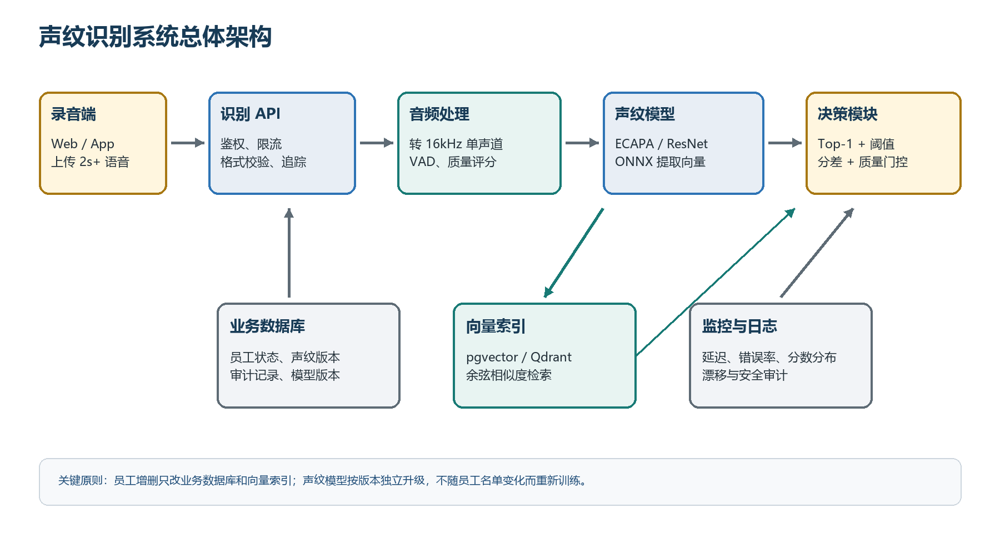
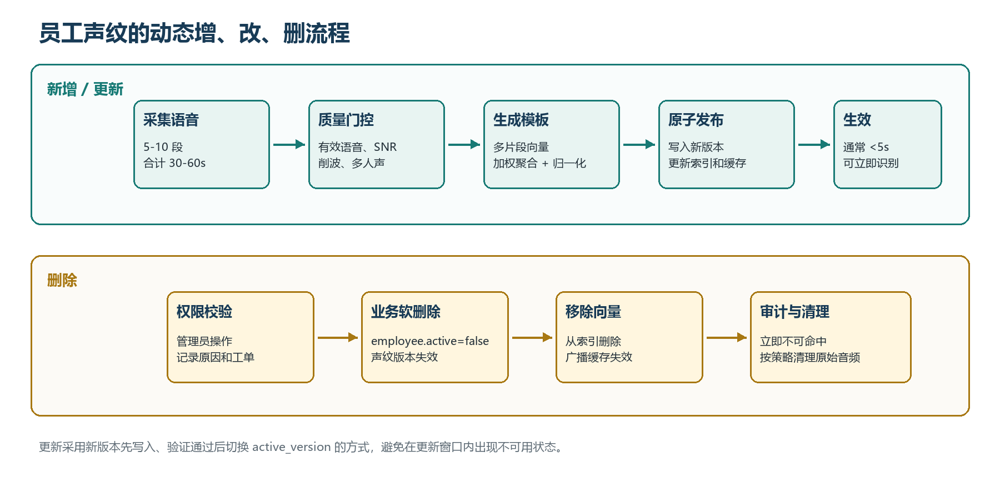

---

title: "员工声纹识别系统详细方案"

version: "V1.0"

date: "2026-07-17"

---

> 技术实施方案

# 员工声纹识别系统

**支持 2 秒以上语音识别、1 分钟内注册及员工动态增删**

| 推荐方案 | 动态维护 | 实施周期 |
| --- | --- | --- |
| 预训练声纹向量 + 开集检索 | 增删员工无需重训模型 | 两人团队约 6 周完成试点 |

- 版本：V1.0

- 日期：2026 年 7 月 17 日

- 适用对象：研发负责人、算法工程师、后端/平台工程师、项目验收人员

## 文档摘要

> **结论：**采用文本无关声纹识别。系统用预训练模型把语音转换为固定维度声纹向量，员工注册时保存多个向量及聚合模板，识别时做余弦相似度检索并通过阈值拒绝未知人员。新增、更新、删除员工只更新数据库和向量索引，模型无需跟随员工名单重训。

本方案以两人研发团队可在约 6 周内完成可用试点为约束，优先选择组件少、部署简单、可逐步扩展的技术栈。MVP 推荐 Python + FastAPI + ONNX Runtime + Silero VAD + SpeechBrain/WeSpeaker 声纹模型 + PostgreSQL/pgvector + Redis + Docker。员工规模超过 5 万、查询并发显著上升时，再把向量检索替换为 Qdrant 或 Milvus。

| 需求 | 方案响应 | 验收口径 |
| --- | --- | --- |
| 输入语音不少于 2 秒 | VAD 后的有效人声不少于 2 秒；推荐 3-10 秒 | 不足 2 秒返回明确的重录状态，不强行识别 |
| 每人可录 1 分钟以内 | 建议 5-10 段、合计 30-60 秒，跨句子/距离/环境采集 | 注册通过率、质量报告、模板版本均可追踪 |
| 短时间识别员工 | ONNX 声纹向量提取 + 内积/余弦 Top-K 检索 | 参考目标：服务端 P95 不高于 800 ms，不含上传网络 |
| 员工动态增加或删除 | 向量 Upsert/Delete + 缓存失效 + 业务状态校验 | 变更 5 秒内生效，删除后不得再命中 |
| 非员工语音处理 | 开集阈值、Top1-Top2 分差和质量门控 | 返回 unknown/low_quality，而不是强行匹配某员工 |

### 阅读导航

- 第 1-3 章说明需求边界、总体架构和核心算法。

- 第 4-6 章说明员工动态管理、系统模块、数据模型、接口与技术栈。

- 第 7-9 章给出数据采集、指标、测试与 6 周实施计划。

- 第 10 章给出两人逐周分工、代码归属和联调约定。

- 第 11-14 章覆盖安全运维、风险、资源估算和最终验收清单。

## 1. 项目概述

### 1.1 需求解释

业务问题属于文本无关的说话人识别（speaker identification）：查询语音内容可以任意，系统需要判断说话人是否属于当前员工集合，并在属于时返回对应员工。因为查询者可能是非员工，所以实际必须按开集识别设计，而不能只做“从 n 个人中总选一个”的闭集分类。

> **关键边界：**“2 秒以上”应解释为 VAD 去除静音后的有效人声时长不少于 2 秒。包含大量静音、背景音乐、多人同时说话或严重削波的 2 秒音频不能视为合格输入。

### 1.2 项目目标

- 员工在 1 分钟以内完成一次声纹注册，系统生成可版本化、可删除的声纹模板。

- 输入至少 2 秒有效人声，在较短时间内返回 matched、unknown 或 low_quality 三类结果。

- 新增、更新、停用或删除员工时，不需要重新训练分类模型，也不需要全量重建服务。

- 以可量化指标评估准确率、未知人误接收率、员工误拒率、时延和变更生效时间。

- 保留后续模型升级、反欺骗、横向扩容和多组织隔离能力。

### 1.3 非目标与限制

- 第一阶段不把语音转写内容作为主要识别依据；ASR 只在随机口令活体校验时可选使用。

- 第一阶段不处理会议中多人重叠说话的说话人分离；检测到多人声或高重叠概率时拒绝并要求重录。

- 声纹识别不是绝对身份凭证。用于门禁、支付、考勤处罚等高风险场景时，应与账号、设备、随机口令或人工复核组合。

- 文档中的准确率与时延是项目目标，必须用实际员工、实际设备和实际环境的试点数据确认，不能视为脱离场景的保证值。

### 1.4 建议的场景假设

| 维度 | 默认假设 | 超出时的调整 |
| --- | --- | --- |
| 员工规模 n | 1-10,000 人 | 10,000-50,000 仍可用 pgvector；更大规模评估 Qdrant/Milvus |
| 查询长度 | 2-10 秒有效人声 | 长音频分窗提取后做质量加权聚合 |
| 注册长度 | 30-60 秒，总长不超过 1 分钟 | 最低可降至 15 秒，但准确率和鲁棒性风险上升 |
| 语言 | 普通话为主，可包含方言/其他语言 | 选文本无关模型并在多语言样本上验证 |
| 设备 | 手机、电脑麦克风、电话录音 | 按设备域分别统计分数并校准阈值 |
| 并发 | MVP 5-20 QPS | 增加推理副本、批处理或 GPU；向量库独立扩容 |

## 2. 总体方案

### 2.1 推荐技术路线

1. 录音统一转为 16 kHz、单声道、16-bit PCM，并做 VAD、有效时长、信噪比、削波和多人声检查。

1. 使用预训练的文本无关声纹模型提取 192/256 维 L2 归一化向量；上线推理使用 ONNX Runtime。

1. 员工注册阶段从多段音频提取多个向量，剔除离群片段后按质量加权求均值，形成员工聚合模板，同时保留分段向量用于鲁棒检索。

1. 识别阶段以余弦相似度检索 Top-K，结合绝对阈值、Top1-Top2 分差、音频质量和员工状态做最终判定。

1. 新增或更新员工用 Upsert 发布新声纹版本；删除员工先令业务状态失效，再删除向量并广播缓存失效。

1. 模型升级走独立的 model_version 流程，支持双版本重算和灰度切换，不与员工日常增删耦合。



_图 1 声纹识别系统总体架构_

### 2.2 为什么不采用 n 类分类模型

| 方案 | 优点 | 主要问题 | 结论 |
| --- | --- | --- | --- |
| n 类分类器 | 训练后推理直接输出员工类别 | 员工新增/删除会改变类别集合；需要重训或修改输出层；难拒绝未知人；小样本易过拟合 | 不推荐 |
| 声纹向量 + 检索 | 员工集合与模型解耦；动态增删；可做 unknown；可跨规模扩展 | 需要阈值校准和向量库管理 | 推荐 |
| 端到端声纹微调 | 有足够内部数据时可提升特定环境效果 | 数据、标注、训练和回归成本高 | 作为第二阶段优化 |

### 2.3 端到端识别流程

1. 接收音频和租户/组织信息，验证文件类型、大小、采样率、调用权限和员工范围。

1. 使用 FFmpeg 解码并统一格式；VAD 删除长静音，计算 effective_speech_seconds。

1. 执行质量门控。有效人声不足、严重削波、SNR 过低或多人重叠时直接返回 low_quality。

1. 把有效语音切成约 2-4 秒窗口，必要时 50% 重叠；每个窗口提取声纹向量和质量权重。

1. 聚合查询向量并在 active 员工向量中执行 Top-K 余弦检索。

1. 使用 top1_score >= threshold、top1_score - top2_score >= margin_threshold、质量合格三个条件判定 matched，否则返回 unknown 或 ambiguous。

1. 记录去标识化的识别事件、耗时、模型版本、阈值版本和分数，不默认永久保存原始查询音频。

## 3. 核心算法设计

### 3.1 声纹模型候选

| 候选 | 特点 | 适用性 | 建议 |
| --- | --- | --- | --- |
| SpeechBrain ECAPA-TDNN | 生态成熟、资料多、易导出；适合快速建立基线 | 两人团队 MVP | 首选基线之一 |
| WeSpeaker ECAPA/ResNet | 面向说话人识别，模型与训练工具完整；可选择更适合中文/多语的数据模型 | 中文员工场景和后续微调 | 与 SpeechBrain 同场测评 |
| NVIDIA NeMo SpeakerNet/Titanet | 训练与部署工具完善，GPU 生态较好 | 已有 NVIDIA 推理平台 | 备选 |
| 自研轻量 CNN | 可完全控制模型 | 需要大量数据与经验；首版风险高 | 不作为首版 |

> **选型方法：**不要只看公开数据集指标。应在内部小型基准集上同时比较 2 秒、5 秒、手机、电脑、电话、噪声和跨天录音。最终以 unknown FAR、员工 FRR、Top-1、CPU 时延和 ONNX 一致性共同决定。

### 3.2 音频预处理与质量门控

| 检查项 | 建议规则 | 不通过时处理 |
| --- | --- | --- |
| 格式 | 解码后统一为 16 kHz、单声道、16-bit PCM | 转码失败返回 INVALID_AUDIO |
| 有效人声 | VAD 后不少于 2.0 秒；注册建议不少于 15 秒 | 返回 INSUFFICIENT_SPEECH |
| 信噪比 | 试点初值可设 10 dB，按设备域调整 | 低于阈值要求重录 |
| 削波 | 绝对幅值接近满量程的采样占比建议低于 1% | 严重削波拒绝 |
| 响度 | 过低或过高给出重录提示；归一化仅做温和处理 | 避免过度增强改变声纹 |
| 多人声/重叠 | 检测到多说话人或明显重叠则拒绝 | 返回 MULTI_SPEAKER |
| 静音/音乐 | 背景音乐不计入有效人声；长静音移除 | 有效时长不足则重录 |

### 3.3 注册模板生成

推荐每名员工录制 5-10 段短语音，每段约 4-10 秒，总有效人声 30-60 秒。多段录音比单段 60 秒更容易发现质量问题，也便于覆盖说话速度、音量、麦克风距离和轻微环境变化。注册流程如下：

1. 逐段执行质量检测并生成 embedding；不合格片段单独重录，不让一段坏音频污染整套模板。

1. 计算片段向量间的两两相似度，删除与其余片段平均相似度显著偏低的离群片段。

1. 按有效时长、SNR、削波率等生成质量权重，对保留向量做加权平均并再次 L2 归一化。

1. 保存聚合模板、3-5 个代表性分段向量、质量摘要、model_version、preprocess_version 和 created_at。

1. 用留出片段回测本人相似度，并和当前员工库抽样做冒名分数检查；低置信注册进入人工复核。

### 3.4 检索与开集判定

设查询声纹向量为 q，员工 i 的模板为 e_i，二者均已 L2 归一化，则余弦相似度可直接用内积 s_i = q · e_i 计算。系统取得最高分 s1、第二高分 s2，并按以下逻辑判定：

> **推荐判定规则：**matched 当且仅当 quality_pass=true、s1 >= τ、s1-s2 >= δ 且候选员工 active=true；若质量不合格返回 low_quality；其余情况返回 unknown/ambiguous。τ 和 δ 必须由验证集校准并绑定 threshold_version。

- 绝对阈值 τ 控制非员工被误认为员工的风险。阈值越高，误接收率降低，但员工误拒率上升。

- 分差阈值 δ 防止两个相似员工分数接近时强行给出答案，尤其适合查询只有 2 秒的情况。

- 可同时检索员工聚合模板和分段向量。聚合模板用于稳定排序，分段向量用于覆盖跨设备/跨环境变化。

- 返回接口可包含 score 和 decision_reason 供调试，但普通业务端不宜展示其他员工候选名单。

### 3.5 阈值校准方法

1. 构造 genuine 对：同一员工不同日期/设备的查询与模板；构造 impostor 对：不同员工以及外部非员工查询。

1. 分别统计 2 秒、5 秒、手机、电脑、电话、安静和噪声条件的 genuine/impostor 分数分布。

1. 先按业务安全要求确定 unknown FAR 上限，例如 1%；在满足上限的阈值中选择 FRR 较低的点。

1. 用 Top1-Top2 分差进一步降低相似声线误判；必要时按设备域或质量档位设置分层阈值。

1. 阈值发布时记录版本、验证集、指标和审批人；模型或预处理版本变化后必须重新校准。

### 3.6 反重放与深度伪造

纯文本无关声纹会受到录音重放、合成语音和语音转换攻击。若系统只用于低风险的内部辅助识别，可以先记录风险并限制权限；若用于身份认证，应把以下能力纳入正式范围：

- 随机口令：服务端给出随机数字或短句，ASR 校验内容，声纹校验说话人，降低固定录音重放风险。

- 反欺骗模型：使用 ASVspoof 类数据训练/选型的 replay/deepfake 检测器，作为独立质量分数输入。

- 设备与会话信号：结合登录账号、设备指纹、时间、IP、失败次数和异常地理位置做风控。

- 不确定结果人工复核：高风险操作不允许仅凭一个声纹匹配结果自动通过。

## 4. 员工动态增删与模型版本管理



_图 2 员工声纹动态增、改、删流程_

### 4.1 新增员工

1. 先在业务库创建 employee_id，并确保该标识不包含敏感明文；员工状态为 pending_enrollment。

1. 采集多段语音并逐段返回质量结果，达到最小有效时长和片段数后创建 enrollment_job。

1. 生成新 voiceprint_profile 和 vectors，执行本人回测、离群检查和冒名分数抽样。

1. 在同一发布事务中把 profile 标为 active、写入 active_version、Upsert 向量并发送缓存失效消息。

1. 发布完成后状态变为 active；若任一步失败，旧版本不受影响，任务可重试。

### 4.2 更新员工声纹

员工换设备、声带状态长期变化或原注册质量较差时，可以创建新版本。更新应采用先生成、后切换：新版本在后台完成质量和回归检查，切换 active_version 后再异步清理旧向量。保留短期回滚窗口，例如 7-30 天。

### 4.3 删除或停用员工

- 先将 employee.active 或 voiceprint_profile.status 设为 disabled，识别结果层再次校验状态，确保即使索引删除延迟也不会返回该员工。

- 再从向量索引删除该员工全部 active/legacy 向量，向所有推理实例广播缓存失效。

- 按制度决定原始注册音频和声纹模板是立即物理删除，还是在审计保留期后清理。

- 删除操作必须鉴权、二次确认、记录操作者、时间、原因、对象版本和执行结果。

### 4.4 一致性与并发控制

| 问题 | 设计 |
| --- | --- |
| 更新中断 | 新版本默认 inactive，完整生成并验证后再原子切换 active_version |
| 数据库与索引不一致 | Outbox 事件表 + 可重试消费者；识别返回前再次校验业务状态 |
| 缓存陈旧 | 版本号作为缓存键；发布和删除时广播失效；设置短 TTL 作为兜底 |
| 重复请求 | enrollment_request_id / idempotency_key 保证幂等 |
| 并发更新 | employee_id 级乐观锁或分布式锁；只允许一个发布任务进入切换阶段 |
| 回滚 | 保留上一 active 版本和索引快照引用，可在分钟级回切 |

### 4.5 模型升级与员工增删解耦

员工增删只影响同一模型版本下的声纹模板。模型升级时 embedding 空间通常发生变化，旧向量不能直接与新模型查询向量比较，因此应建立独立迁移流程：

1. 注册音频仍在保留期时，用新模型离线重算所有员工模板；若不保留原始音频，则需要员工重新注册。

1. 新旧模型并行建立两套索引，使用同一验证集完成准确率、FAR/FRR、时延和资源回归。

1. 灰度一部分请求到新版本，只记录对比结果或在低风险流量中实际返回。

1. 达标后原子切换 current_model_version；保留回滚窗口，最后清理旧索引。

## 5. 系统模块与接口设计

### 5.1 服务模块

| 模块 | 职责 | 实现建议 |
| --- | --- | --- |
| 录音端 | 采集、时长提示、录音片段管理、上传 | Web MediaRecorder 或 App 原生录音；服务端统一转码 |
| API 服务 | 鉴权、限流、校验、业务编排、响应 | FastAPI + Pydantic；OpenAPI 自动文档 |
| 音频处理 | 解码、重采样、VAD、质量评分、切窗 | FFmpeg + Silero VAD；封装为可测试的纯函数 |
| 声纹推理 | 加载 ONNX、批量提取 embedding、聚合 | ONNX Runtime；CPU 默认，GPU 可选 |
| 向量检索 | Top-K 相似度搜索、增删向量 | MVP PostgreSQL/pgvector；规模提升后 Qdrant/Milvus |
| 员工/版本管理 | 员工状态、模板版本、发布、回滚 | PostgreSQL 事务 + Outbox |
| 任务队列 | 长注册音频处理、重算、索引同步 | MVP 可同步；生产可用 Redis Queue/Celery/ARQ |
| 监控审计 | 指标、日志、分数漂移、安全操作审计 | Prometheus/Grafana + Loki/ELK + 审计表 |

### 5.2 核心数据模型

| 表 | 关键字段 | 说明 |
| --- | --- | --- |
| employees | employee_id, org_id, status, active_voiceprint_version | 员工业务主表；识别返回前必须校验 active |
| voiceprint_profiles | profile_id, employee_id, model_version, preprocess_version, status, quality_summary | 一次注册/更新生成一个版本 |
| voiceprint_vectors | vector_id, profile_id, vector_type, embedding, quality_weight | 聚合模板和代表性分段向量；pgvector 字段 |
| enrollment_jobs | job_id, idempotency_key, status, error_code, metrics | 注册任务状态、重试和错误诊断 |
| recognition_events | trace_id, decision, score, margin, latency_ms, versions | 默认不含原始音频；用于质量监控与审计 |
| model_versions | model_version, artifact_uri, checksum, threshold_version, status | 模型、阈值和预处理版本绑定 |
| outbox_events | event_id, event_type, payload, delivered_at | 保证数据库与向量索引/缓存最终一致 |

### 5.3 API 设计

| 接口 | 用途 | 关键响应 |
| --- | --- | --- |
| POST /v1/employees/{id}/enroll | 上传 1 个或多个注册片段，创建/更新声纹版本 | job_id, status, quality_report, profile_version |
| GET /v1/enrollment-jobs/{job_id} | 查询注册任务和失败原因 | pending/processing/succeeded/failed |
| POST /v1/identify | 上传查询语音并在指定组织内识别 | matched/unknown/low_quality, employee_id, score, latency_ms |
| DELETE /v1/employees/{id}/voiceprint | 停用并删除声纹 | deleted_at, affected_versions, index_sync_status |
| GET /v1/employees/{id}/voiceprint | 查看状态、质量和版本，不返回原始向量 | status, active_version, quality_summary |
| GET /health/live 与 /health/ready | 容器存活和依赖就绪检查 | 模型、数据库、索引、缓存状态 |

### 5.4 识别响应示例

```json
{
  "trace_id": "8a2d...",
  "decision": "matched",
  "employee_id": "emp_1024",
  "score": 0.782,
  "margin": 0.094,
  "quality": {"effective_speech_seconds": 2.83, "grade": "B"},
  "model_version": "speaker-embed-v1",
  "threshold_version": "threshold-2026-07",
  "processing_ms": 286
}
```

### 5.5 错误码

| 错误码 | 含义 | 客户端动作 |
| --- | --- | --- |
| INVALID_AUDIO | 无法解码、空文件或不支持的封装 | 检查格式后重录/重传 |
| INSUFFICIENT_SPEECH | VAD 后有效人声不足 2 秒 | 继续录音，避免长静音 |
| LOW_SNR | 噪声过大 | 靠近麦克风并换安静环境 |
| CLIPPING | 录音削波严重 | 降低输入增益或远离麦克风 |
| MULTI_SPEAKER | 检测到多人声/重叠 | 仅保留一人说话 |
| UNKNOWN_SPEAKER | 没有候选达到阈值 | 按业务流程重试或人工确认 |
| AMBIGUOUS_MATCH | Top-1 与 Top-2 分差不足 | 延长录音或使用随机口令 |
| PROFILE_DISABLED | 员工声纹已停用 | 不应重试，联系管理员 |

## 6. 技术栈与部署建议

### 6.1 MVP 推荐栈

| 层次 | 技术 | 选择理由 |
| --- | --- | --- |
| 语言与模型实验 | Python 3.11/3.12、PyTorch 2.x、torchaudio | 声纹生态成熟，便于评估和必要的微调 |
| 模型工具 | SpeechBrain 或 WeSpeaker | 提供成熟的 ECAPA/ResNet 模型与说话人识别流程 |
| 在线推理 | ONNX Runtime | 降低 Python/PyTorch 在线依赖，CPU 性能和部署一致性更好 |
| 音频处理 | FFmpeg、Silero VAD（WebRTC VAD 可作轻量备选） | 格式覆盖广，VAD 易部署 |
| 服务框架 | FastAPI、Pydantic、Uvicorn/Gunicorn | 接口开发快，类型校验和 OpenAPI 友好 |
| 业务数据库 | PostgreSQL 16+ | 员工、版本、任务、审计与事务管理 |
| 向量检索 | pgvector | 员工规模中小时减少系统组件；支持余弦/内积索引 |
| 缓存/队列 | Redis 7+；按需引入 ARQ/Celery/RQ | 缓存员工状态、任务编排和失效通知 |
| 对象存储 | MinIO/S3 兼容存储（可选） | 仅在合规允许时短期保存注册音频或模型文件 |
| 前端 | React/Vue + TypeScript + MediaRecorder（可选） | 提供注册、重录和质量反馈界面 |
| 交付运维 | Docker Compose；生产可升级 Kubernetes | MVP 简单，后续可横向扩容 |
| 可观测性 | Prometheus、Grafana、Loki/ELK | 指标、告警、日志和审计 |
| 测试 | pytest、httpx、Locust/k6 | 单元、接口、并发和端到端测试 |

### 6.2 向量检索选型

| 方案 | 适合规模/阶段 | 优势 | 注意点 |
| --- | --- | --- | --- |
| NumPy/FAISS IndexFlatIP | 原型、单进程、小规模 | 实现最简单，精确检索 | 持久化、动态删除和多副本一致性需自建 |
| PostgreSQL + pgvector | MVP 到约 5 万员工，中低 QPS | 数据库和向量一体，事务与运维简单 | 更大规模/更高并发需调优或拆分 |
| Qdrant | 5 万以上或需要独立向量服务 | 动态增删、过滤、部署相对轻量 | 增加独立组件和数据一致性工作 |
| Milvus | 大规模、高吞吐、多索引场景 | 扩展能力强、生态完整 | 对两人 MVP 偏重，运维复杂度高 |

> **推荐：**若 n 未知但预计低于 5 万，先用 PostgreSQL + pgvector。它足以满足动态 Upsert/Delete 和组织过滤，也让两人团队少维护一个分布式系统。只有真实压测显示数据库成为瓶颈时再迁移。

### 6.3 部署拓扑

| 阶段 | 部署 | 建议资源 |
| --- | --- | --- |
| 本地开发 | Docker Compose：API/推理、PostgreSQL/pgvector、Redis | 开发机 8 核 CPU、16 GB 内存；无 GPU 也可 |
| 试点 | 1-2 个 API/推理副本 + 托管或独立 PostgreSQL + Redis | 服务 8 核/16 GB；数据库 4 核/8 GB；按并发测算 |
| 生产 | 负载均衡 + 多推理副本 + 高可用 PostgreSQL/向量库 + 监控 | CPU 优先；高 QPS 或更长音频再引入 GPU |
| 大规模 | 推理池、独立向量服务、异步重算任务、对象存储 | 按 QPS、员工数和 SLA 横向扩展 |

### 6.4 容量估算

以 256 维 float32 向量计算，单向量原始数据约 1 KB。每人保存 1 个聚合向量和 4 个代表性分段向量，约 5 KB/人；10 万员工原始向量约 500 MB，另加索引和元数据开销。该规模通常不是存储瓶颈，模型推理、并发和高可用比容量更值得优先测试。

## 7. 数据采集、评估集与隐私

### 7.1 注册录音规范

| 项目 | 规范 |
| --- | --- |
| 片段数量 | 5-10 段；避免只录一段很长的音频 |
| 总有效时长 | 建议 30-60 秒，硬上限 60 秒；最低可接受值在试点后确定 |
| 内容 | 任意自然语句，覆盖不同音节；不要反复朗读同一句 |
| 环境 | 至少包含主要使用环境；可在安静环境和轻噪环境分别采样 |
| 设备 | 尽量使用实际查询设备；如手机和电脑都用，应各留样本 |
| 时间 | 条件允许时跨两个时段采集，降低一次性嗓音状态偏差 |
| 操作提示 | 一人说话、距离稳定、避免音乐、回声和触碰麦克风 |

### 7.2 试点评估集

当 n 不大于 200 时，建议覆盖全部员工；n 较大时至少抽取 50-100 名具有代表性的员工。每名员工应准备与注册音频不同的查询片段，并加入非员工样本。参考规模如下：

- 每名员工至少 20 条查询：2 秒、5 秒各若干，跨天、跨设备、安静和噪声条件均覆盖。

- 非员工至少 20-50 人，每人 5-10 条，用于估计 unknown FAR；人数越多，低 FAR 的估计越可靠。

- 注册集、阈值验证集和最终测试集按人员或会话严格隔离，避免同一录音切片泄漏。

- 对年龄、性别、口音、设备和环境分组报告指标，发现某一群体明显退化时不得只看总体平均值。

### 7.3 隐私与数据治理

> **敏感性：**声纹模板属于生物特征类敏感数据。即使只保存 embedding，也不能当作普通业务字段处理；应取得合法授权并执行最小化、加密、访问控制、留存与删除制度。

- 传输使用 TLS；数据库、对象存储和备份加密；密钥由 KMS 或独立密钥管理服务托管。

- employee_id 使用内部不可猜标识，声纹库不保存姓名、手机号等不必要明文；展示信息从受控业务库关联。

- 默认不长期保存查询音频。注册原始音频是否保留由模型升级需求与隐私制度共同决定，并设置明确 TTL。

- 操作权限分为注册、识别、删除、审计和模型管理；删除与批量导出采用更高权限并记录审计。

- 日志禁止打印原始音频、完整 embedding、令牌或过多个人信息；调试样本进入隔离环境并定期清理。

## 8. 指标、验收标准与测试

### 8.1 关键指标定义

| 指标 | 定义 | 建议试点目标 |
| --- | --- | --- |
| Known Top-1 | 已注册员工且系统给出正确员工的比例 | 清洁 2 秒、n<=500 时目标 >=95%；5 秒目标 >=98% |
| Unknown FAR | 非员工被错误接收为某员工的比例 | 目标 <=1%，高风险场景应进一步降低 |
| Known FRR | 已注册员工被判 unknown/ambiguous 的比例 | 目标 <=5%，并分 2 秒/5 秒报告 |
| Ambiguous Rate | 因 Top1-Top2 分差不足而拒绝的比例 | 单独报告，确认是否集中在特定员工对 |
| P95 延迟 | 服务端从开始处理到产生结果，不含上传网络 | 2-10 秒语音、n<=10,000 时 <=800 ms |
| 向量搜索 P95 | Top-K 检索耗时 | n<=10,000 时 <=20 ms |
| 注册处理时间 | 60 秒以内音频生成并发布模板 | 同步目标 <=5 秒；异步则任务可追踪 |
| 变更生效 | 新增/更新/删除到所有实例一致 | 目标 <=5 秒；删除后业务层立即禁用 |
| 可用性 | API 成功服务时间 | 试点 >=99.5%，生产按业务等级提高 |

上述准确率是建议目标，适用于相对清洁、有效人声达到要求的样本。若真实环境包含远场、强混响、电话窄带、多人重叠或刻意攻击，应为不同条件单独制定目标，不能把所有样本混成一个平均数。

### 8.2 功能与异常测试矩阵

| 场景 | 输入 | 期望结果 |
| --- | --- | --- |
| 正常识别 | 已注册员工，2/5/10 秒 | 返回 matched 且 employee_id 正确 |
| 非员工 | 未注册人员 | 返回 unknown，不强行给出员工 |
| 短语音 | VAD 后 1.9 秒 | INSUFFICIENT_SPEECH |
| 长静音 | 文件 5 秒但人声 1 秒 | 按有效人声判断并拒绝 |
| 噪声/削波 | 低 SNR 或满量程削波 | low_quality 与明确原因 |
| 多人同时说话 | 重叠人声 | MULTI_SPEAKER 或 low_quality |
| 相似声线 | Top1/Top2 接近 | AMBIGUOUS_MATCH，不冒险输出 |
| 新增员工 | 发布后立即查询 | 5 秒内可匹配 |
| 删除员工 | 删除前后连续查询 | 删除后立即不可返回该员工 |
| 重复注册请求 | 相同 idempotency_key | 只生成一个版本 |
| 依赖故障 | 数据库/向量库/缓存异常 | 正确降级或 5xx；不返回错误身份 |
| 模型回归 | 固定金标音频集 | 版本升级指标不低于发布门槛 |
| 重放/合成 | 录音播放或 TTS/VC | 启用反欺骗时拒绝；未启用时记录已知风险 |

### 8.3 性能测试

- 分别测 2 秒、5 秒、10 秒和 60 秒音频；报告解码、VAD、embedding、检索、业务判断各阶段耗时。

- 在 n=100、1,000、10,000、50,000 的模拟向量库上测搜索时延和内存，避免只测空库。

- 以 1、5、10、20 QPS 逐级压测，记录 P50/P95/P99、错误率、CPU、内存和队列长度。

- 执行 30-60 分钟稳定性测试，观察模型内存是否增长、连接池是否耗尽、日志是否阻塞。

- 对新增/删除并发识别做一致性测试，确认旧缓存不会返回已删除员工。

### 8.4 发布门禁

1. 所有自动化测试通过，模型金标集指标达到门槛且无关键群体显著退化。

1. 模型文件、ONNX 导出、阈值和预处理代码均有版本、校验和和可回滚制品。

1. 删除员工、未知人拒绝、依赖故障等高风险路径完成联调和演练。

1. 监控仪表盘、告警、备份恢复、权限审计和数据清理任务已验证。

1. 试点负责人签署指标报告，明确尚未解决的环境和攻击风险。

## 9. 实施计划（建议 6 周）

| 阶段 | 时间 | 主要工作 | 里程碑 |
| --- | --- | --- | --- |
| 需求与基线 | 第 1 周 | 冻结场景、数据规范和指标；搭建代码库、API 骨架；比较 2 个预训练模型 | M1：可从 WAV 提取 embedding 并完成离线相似度测试 |
| 注册链路 | 第 2 周 | 录音/上传、转码、VAD、质量检查、模板聚合、数据表 | M2：一名员工可完成注册并生成版本化模板 |
| 在线识别 | 第 3 周 | Top-K 检索、阈值判定、unknown、接口、日志；建立验证集 | M3：端到端 identify API 可用，输出可解释状态 |
| 动态维护与安全 | 第 4 周 | 新增/更新/删除、幂等、Outbox、缓存；权限与审计；可选反欺骗基线 | M4：员工变更 5 秒内生效，删除后不可命中 |
| 联调与压测 | 第 5 周 | 阈值校准、噪声测试、性能调优、故障演练、监控 | M5：达到试点准确率和 P95 时延目标 |
| 试点与交付 | 第 6 周 | 真实员工试点、缺陷修复、文档、部署脚本、培训和验收 | M6：试点验收，可进入灰度生产 |

### 9.1 阶段性交付物

- 代码：audio_core、speaker_model、vector_repository、API、数据库迁移、测试和部署配置。

- 模型制品：原始模型引用、ONNX 文件、checksum、模型卡、阈值配置和金标回归结果。

- 数据文档：采集规范、字段字典、隐私清单、保留策略和试点评估集说明。

- 运维文档：部署、监控、告警、备份恢复、员工删除、模型回滚和故障处理步骤。

- 验收材料：准确率/FAR/FRR、时延、动态增删、一致性和安全测试报告。

## 10. 两人团队详细分工

> **分工原则：**人员 A 对“模型输出是否可信”负责，人员 B 对“系统是否稳定、数据是否一致”负责。双方通过固定的 embedding 接口、质量报告和版本字段协作，避免算法代码散落在 API 中，也避免后端自行修改阈值逻辑。

### 10.1 角色定义

| 角色 | 主责 | 最终交付责任 |
| --- | --- | --- |
| 人员 A：算法/数据工程师 | 模型选型、音频处理、VAD/质量、embedding、聚合、阈值、评估与模型导出 | 准确率、FAR/FRR、模型性能、数据与模型版本可复现 |
| 人员 B：后端/平台工程师 | API、数据库、向量检索、注册/删除事务、缓存、鉴权、部署、监控和压测 | 接口 SLA、动态一致性、安全权限、部署与可观测性 |
| 共同责任 | 需求冻结、试点采集、端到端联调、风险决策、演示和验收 | 系统整体满足业务目标，文档与交接完整 |

### 10.2 代码与组件归属

| 组件/目录 | 主要负责人 | 复核人 | 接口约定 |
| --- | --- | --- | --- |
| audio_core/ | A | B | 输入音频字节/路径；输出标准波形、VAD 片段和 quality_report |
| speaker_model/ | A | B | embed(waveform)->normalized vector；batch_embed；model_version |
| decision/ | A | B | 输入 Top-K 与质量；输出 matched/unknown/ambiguous 和 reason |
| api/ | B | A | OpenAPI 契约；统一错误码；所有响应带 trace_id 和版本 |
| repositories/ | B | A | 员工、profile、vector、event 的事务与查询接口 |
| index_sync/ | B | A | Upsert/Delete/重试/Outbox；可查询同步状态 |
| evaluation/ | A | B | 固定清单驱动；输出 JSON/CSV 报告和阈值候选 |
| deploy/observability/ | B | A | Docker、环境变量、健康检查、指标和告警 |
| tests/e2e/ | 共同 | 共同 | 金标员工、未知人、动态增删和故障场景 |

### 10.3 逐周详细分工

| 周 | 人员 A：算法/数据 | 人员 B：后端/平台 | 共同检查点 |
| --- | --- | --- | --- |
| 第 1 周 | 定义音频规范；跑通 SpeechBrain/WeSpeaker 两套基线；设计评估集与指标脚本；给出模型候选报告 | 初始化仓库、CI、FastAPI、PostgreSQL/pgvector、Docker；定义 OpenAPI 和数据表；实现上传校验 | 冻结需求、错误码、模型接口、版本字段和试点数据计划 |
| 第 2 周 | 实现转码封装、Silero VAD、有效时长/SNR/削波检查；实现分窗、embedding、聚合和离群检测 | 实现 employees/profile/vector/job 表和迁移；完成 enroll API、任务状态、幂等键和对象存储策略 | 用 5-10 人完成首次注册；核对质量报告和数据库记录 |
| 第 3 周 | 建立 genuine/impostor 分数集；实现 Top-K 后判定、阈值与 margin；导出并验证 ONNX 一致性 | 实现 pgvector 检索、组织过滤、identify API、状态校验、日志和 trace；接入 ONNX 服务 | 完成 known/unknown 端到端演示；固定第一版阈值 |
| 第 4 周 | 测试 2 秒、噪声、跨设备、相似声线；评估反重放基线；完善模型卡和回归集 | 实现更新/删除、Outbox、缓存失效、权限审计、回滚；编写一致性测试 | 演练新增、更新、删除和依赖故障；确认删除后零命中 |
| 第 5 周 | 完成阈值校准、分组指标、误判分析；做 ONNX/量化性能对比；提出模型优化项 | 执行负载/稳定性测试；优化连接池、缓存、批处理和部署；完成监控告警 | 联合出具准确率、FAR/FRR、P95/P99 和容量报告 |
| 第 6 周 | 支持真实员工试点，分析失败样本，冻结模型与阈值版本；整理算法运维手册 | 部署试点环境，完成备份恢复、清理任务、权限复核；整理部署和故障手册 | UAT、培训、演示、验收清单签署和后续迭代 Backlog |

### 10.4 每周产出与完成标准

| 人员 | 每日工作节奏 | 完成标准 |
| --- | --- | --- |
| A | 上午处理模型/数据实验，下午提交可复现脚本和指标；重大阈值变化先写实验记录 | 代码有单测；实验有配置、数据清单、随机种子和结果；ONNX 与 PyTorch 输出误差在约定范围 |
| B | 上午处理 API/数据/部署，下午做集成和可观测性；状态变更必须有事务与失败路径 | 接口有契约测试；数据库迁移可回滚；动态增删有幂等、一致性和审计测试 |
| 共同 | 每天 15 分钟同步阻塞；每两天用固定样本跑一次端到端；每周五做里程碑演示 | 主分支始终可部署；版本字段完整；失败样本可定位到音频质量、模型、阈值或系统依赖 |

### 10.5 双方交接接口

- A 向 B 提供：ONNX 模型、输入输出张量说明、预处理版本、embedding 维度、质量阈值、决策阈值、金标样本和基准时延。

- B 向 A 提供：音频标准化接口、向量仓储接口、Top-K 结果格式、员工状态过滤、trace/日志查询和可复现的集成环境。

- 任何模型或阈值修改必须更新 model_version/threshold_version，并通过固定回归集；任何数据库或索引变更必须通过动态增删一致性测试。

- 联调问题按四类归因：输入质量、模型/阈值、索引/状态、基础设施；每个错误码只能有一个明确主责模块。

## 11. 安全、运维与可观测性

### 11.1 安全控制

| 控制域 | 要求 |
| --- | --- |
| 身份与权限 | OIDC/JWT 或内部网关鉴权；组织级数据隔离；注册、删除、审计分权 |
| 传输与存储 | 全链路 TLS；数据库、对象存储、备份加密；密钥轮换 |
| 接口防护 | 文件大小/格式限制、速率限制、超时、恶意文件扫描、幂等 |
| 数据最小化 | 默认不留查询音频；日志不记完整 embedding；敏感字段脱敏 |
| 操作审计 | 员工新增/更新/删除、批量操作、模型切换和权限变更均记录不可抵赖日志 |
| 高风险识别 | 随机口令 + 反欺骗 + 设备风控；不以声纹单因素自动批准高影响操作 |

### 11.2 监控指标

- 服务：请求量、成功率、P50/P95/P99、各错误码、队列长度、超时、CPU、内存和模型加载状态。

- 模型：matched/unknown/ambiguous 比例、score/margin 分布、质量等级、设备域分布、2 秒与 5 秒指标。

- 数据一致性：Outbox 积压、索引同步延迟、数据库 active 数与索引向量数差异、缓存失效失败。

- 安全：失败重试次数、同设备多员工尝试、删除/导出操作、反欺骗告警和异常调用方。

### 11.3 告警建议

| 告警 | 触发示例 | 处理 |
| --- | --- | --- |
| 识别服务不可用 | 5 分钟错误率 >5% 或 ready 失败 | 切流/回滚，检查模型、数据库、索引依赖 |
| 时延退化 | P95 连续 10 分钟超 SLA | 查看分阶段耗时、CPU、队列和数据库慢查询 |
| 索引不同步 | Outbox 最老事件 >60 秒或数量差异 | 重放事件；识别仍以业务状态为最终门控 |
| 分数漂移 | unknown 比例或平均 score 超出历史区间 | 检查设备/环境变化、模型配置和输入异常 |
| 删除失败 | 业务已禁用但索引删除重试超限 | 维持业务禁用，人工处理索引并审计 |

### 11.4 备份与恢复

- PostgreSQL 做每日全量/持续归档或托管备份，定期演练恢复到指定时间点。

- 向量索引可以从 voiceprint_vectors 重建，但应记录重建脚本、耗时和检查方式；数据库是真实来源。

- 模型、阈值、预处理配置存入版本化制品库并记录 checksum，至少保留当前和上一稳定版本。

- 恢复演练必须验证：员工 active 状态、向量数量、模型版本、阈值版本以及删除记录不被错误复活。

## 12. 风险与应对

| 风险 | 影响 | 应对 |
| --- | --- | --- |
| 2 秒语音信息不足 | 误拒或员工间混淆增加 | 质量门控 + margin；建议 3-5 秒；不确定时重录 |
| 真实环境与公开模型域不一致 | 准确率下降 | 内部基准集选型；按设备域校准；必要时微调 |
| 注册样本单一或质量差 | 跨天/跨设备性能差 | 多片段、多环境、离群剔除、注册回测 |
| 非员工被强制匹配 | 错误身份结果 | 开集阈值、unknown、外部人验证集和 FAR 门槛 |
| 相似声线/亲属 | Top-1 接近 | 分差阈值、延长语音、随机口令或人工复核 |
| 录音重放/深度伪造 | 冒用身份 | 反欺骗、随机口令、设备风控；高风险多因素认证 |
| 员工删除后缓存仍命中 | 隐私与业务违规 | 业务状态二次校验、版本缓存、广播失效和短 TTL |
| 模型升级导致向量不兼容 | 全库识别失败 | 双版本索引、离线重算、灰度切换和回滚 |
| 两人团队组件过多 | 交付延迟、运维负担 | MVP 使用 pgvector 和 Docker Compose；按实测再拆分 |
| 生物特征合规不足 | 法律与信任风险 | 授权、最小化、加密、删除制度、权限与审计 |

## 13. 资源与成本估算

### 13.1 人力

两人全职、6 周约为 12 人周。该估算覆盖试点系统、基础 Web/接口、模型评估、动态增删、监控、测试和交付文档，不覆盖大规模历史音频清洗、复杂移动端、正式等保/合规认证或定制硬件集成。

### 13.2 基础设施

| 环境 | 最低建议 | 说明 |
| --- | --- | --- |
| 开发/演示 | 单机 8 核 CPU、16 GB 内存、50 GB 磁盘 | CPU 可完成 MVP；开发时无需强制 GPU |
| 试点服务 | 8 核/16 GB API 推理节点；4 核/8 GB PostgreSQL | 可同机部署但建议数据与服务分开备份 |
| 可选 GPU | 一张中小型 CUDA 推理 GPU | 仅在高 QPS、长音频或模型较大时引入 |
| 存储 | 按是否保留注册音频决定；向量本身占用很小 | 原始音频通常比向量占用和合规成本高 |

## 14. 最终建议与验收清单

> **最终建议：**先做“不重训即可动态增删”的声纹向量 MVP，使用实际员工环境完成阈值校准；将 unknown 拒绝和低质量重录视为正常产品行为。只有当内部数据证明预训练模型不足时，再进入领域微调或更复杂的反欺骗阶段。

### 14.1 验收清单

- 任意员工可在 1 分钟录音上限内完成注册，质量不合格片段能明确提示并重录。

- 对 VAD 后不少于 2 秒的查询返回 matched/unknown/low_quality，不对未知人强行匹配。

- 试点集 Known Top-1、Unknown FAR、Known FRR 达到双方冻结的门槛，并按时长/设备/环境分组报告。

- n<=10,000 的目标规模下，识别服务 P95 达到约定 SLA，向量检索不是主要瓶颈。

- 新增、更新和删除 5 秒内生效；删除后即使索引同步延迟，也因业务状态校验而无法返回。

- 模型、阈值、预处理和声纹模板均可版本化，可灰度、可回滚、可审计。

- 声纹与音频按敏感数据加密、最小化和受控删除；高风险场景已明确多因素和反欺骗要求。

- 两名成员的代码归属、接口、回归集、部署和故障手册已经完成交接。

## 附录 A：核心判定伪代码

```python
def identify(audio, org_id):
    waveform = decode_and_resample(audio, sr=16000, mono=True)
    segments, quality = vad_and_quality_check(waveform)
    if quality.effective_speech_seconds < 2.0:
        return LOW_QUALITY('INSUFFICIENT_SPEECH')
    if not quality.pass_gate:
        return LOW_QUALITY(quality.reason)

    query = l2_normalize(weighted_mean(model.embed(segments)))
    topk = vector_index.search(query, org_id=org_id, active_only=True, k=5)
    top1, top2 = topk[0], topk[1]

    if not employee_repo.is_active(top1.employee_id):
        return UNKNOWN('PROFILE_DISABLED')
    if top1.score < threshold.absolute:
        return UNKNOWN('BELOW_THRESHOLD')
    if top1.score - top2.score < threshold.margin:
        return UNKNOWN('AMBIGUOUS_MATCH')
    return MATCHED(top1.employee_id, top1.score, top1.score-top2.score)
```

## 附录 B：配置项建议

| 配置 | 初始建议 | 说明 |
| --- | --- | --- |
| MIN_EFFECTIVE_SPEECH_SECONDS | 2.0 | 硬门槛；查询文件总时长不能替代有效人声时长 |
| ENROLL_TARGET_SECONDS | 30-60 | 注册推荐有效人声总时长 |
| WINDOW_SECONDS | 2-4 | 分窗长度，按模型输入和内部实验确定 |
| TOP_K | 5 | 用于分差、调试和候选状态过滤 |
| ABSOLUTE_THRESHOLD | 由验证集校准 | 不得直接照搬公开示例数值 |
| MARGIN_THRESHOLD | 由验证集校准 | 降低相似员工混淆 |
| RAW_QUERY_AUDIO_TTL | 0 或极短 | 默认不保存查询原始音频 |
| RAW_ENROLL_AUDIO_TTL | 按制度 | 影响模型升级时能否离线重算 |
| CACHE_TTL_SECONDS | 30-60 | 广播失效失败时的兜底；删除仍由业务状态立即门控 |
| MODEL_VERSION | 显式固定 | 响应、日志、向量和阈值都必须记录 |

## 附录 C：上线后迭代优先级

| 优先级 | 迭代 | 触发条件 |
| --- | --- | --- |
| P0 | 修复未知人误接收、删除后命中、权限越界、模型版本错配 | 任何一次出现即阻断发布 |
| P1 | 按设备/环境分层阈值、注册质量提升、ONNX/量化优化 | 试点指标或时延未达标 |
| P1 | 随机口令和反欺骗 | 用于认证、门禁、考勤等高风险业务 |
| P2 | Qdrant/Milvus、GPU 推理、自动扩缩容 | 员工数/QPS 压测证明现有组件成为瓶颈 |
| P2 | 领域微调或蒸馏 | 预训练模型在充分校准后仍无法满足关键场景 |
| P3 | 多人说话分离、说话人日志、跨会话聚类 | 业务明确需要会议/通话分析，而非单人短语音识别 |
