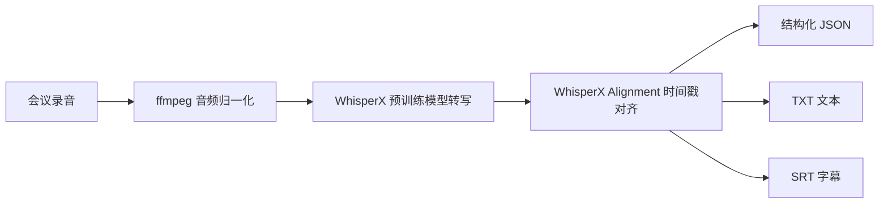

# 第一阶段：WhisperX 语音转文本部署与评测文档

## 1. 阶段目标

第一阶段聚焦实习任务中的“AI 语音大模型部署与推理优化”部分，目标是在本地或服务器环境中基于 WhisperX 预训练大模型，完成线下多语种混合会议音频的语音转文本（STT）基础能力建设。

本阶段不处理员工声纹识别和说话人身份映射，这些属于后续阶段。第一阶段只需要把会议音频稳定转成带时间戳的文本，并形成后续 Speaker Diarization、声纹库和 Agent Workflow 可以继续消费的数据结构。

## 2. 本阶段已完成交付

代码目录：

```text
F:\实习\voiceprint_solution_work\phase1_whisperx_stt
```

核心文件：

```text
phase1_whisperx_stt/
  README.md
  requirements.txt
  config.example.json
  scripts/
    transcribe.py
    benchmark.py
  src/
    whisperx_stt/
      __init__.py
      audio.py
      transcriber.py
```

已具备能力：

- 单个会议音频转写。
- 自动或指定语种识别，支持中文、英文和混合语音场景。
- 音频归一化：统一为 16kHz、单声道 WAV。
- WhisperX 转写与可选时间戳对齐。
- 输出 JSON、TXT、SRT 三种格式。
- 批量评测多条音频，统计耗时和 RTF。
- 为第二阶段说话人分离预留结构化输入。

## 3. 技术路线

第一阶段采用“音频预处理 + WhisperX 推理 + 时间戳对齐 + 结果序列化”的流程。



各模块职责：

| 模块 | 作用 | 当前实现 |
|---|---|---|
| 音频预处理 | 统一采样率、声道和格式 | `audio.py` |
| STT 推理 | 加载 WhisperX 模型并转写 | `transcriber.py` |
| 时间戳对齐 | 获得更准确的词/句级时间戳 | `transcriber.py` |
| 单文件入口 | 处理一个会议录音 | `scripts/transcribe.py` |
| 批量评测入口 | 批量统计耗时和 RTF | `scripts/benchmark.py` |

## 4. 环境要求

推荐环境：

| 类型 | 推荐 |
|---|---|
| 操作系统 | Windows / Linux |
| Python | 3.10 或 3.11 |
| GPU | NVIDIA GPU，建议 8GB 显存以上 |
| CUDA | 与 PyTorch 版本匹配 |
| 音频工具 | ffmpeg、ffprobe |
| 核心依赖 | WhisperX、PyTorch、torchaudio |

安装依赖：

```powershell
cd F:\实习\voiceprint_solution_work\phase1_whisperx_stt
python -m venv .venv
.\.venv\Scripts\Activate.ps1
pip install -r requirements.txt
```

检查 ffmpeg：

```powershell
ffmpeg -version
ffprobe -version
```

如果系统 PATH 中没有全局 `ffmpeg`，当前项目会使用 `imageio-ffmpeg` 提供的内置 ffmpeg，并在项目 `.bin` 目录下自动准备 `ffmpeg.exe` 供 WhisperX 调用。因此第一阶段不再强依赖系统级 ffmpeg 安装。

## 5. 单文件转写流程

命令示例：

```powershell
python .\scripts\transcribe.py `
  --input "F:\实习\data\meeting_demo.wav" `
  --output-dir "F:\实习\voiceprint_solution_work\phase1_whisperx_stt\outputs" `
  --model medium `
  --device auto `
  --compute-type auto `
  --language auto `
  --batch-size 16
```

关键参数说明：

| 参数 | 含义 | 建议 |
|---|---|---|
| `--model` | WhisperX 模型大小 | 初期用 `medium`，效果不够再换更大模型 |
| `--device` | 推理设备 | 有 GPU 用 `cuda`，不确定用 `auto` |
| `--compute-type` | 推理精度 | GPU 默认 `float16`，CPU 默认 `int8` |
| `--language` | 语种 | 多语种会议用 `auto` |
| `--batch-size` | 批处理大小 | 显存足够可增大 |
| `--no-align` | 关闭对齐 | 调试速度时可开启 |
| `--no-normalize` | 跳过音频归一化 | 已经是标准 WAV 时可开启 |

输出文件：

```text
outputs/
  meeting_demo.transcript.json
  meeting_demo.transcript.txt
  meeting_demo.transcript.srt
  _normalized_audio/
    meeting_demo.16k_mono.wav
```

## 6. 输出数据结构

JSON 输出示例：

```json
{
  "audio_path": "F:\\实习\\phase1_whisperx_stt\\outputs\\_normalized_audio\\meeting_demo.16k_mono.wav",
  "source_audio_path": "F:\\实习\\data\\meeting_demo.wav",
  "model": "medium",
  "language": "zh",
  "device": "cuda",
  "compute_type": "float16",
  "batch_size": 16,
  "align": true,
  "elapsed_seconds": 18.42,
  "segments": [
    {
      "id": 0,
      "start": 0.52,
      "end": 5.81,
      "text": "大家下午好，我们开始今天的项目例会。"
    }
  ],
  "text": "大家下午好，我们开始今天的项目例会。"
}
```

字段说明：

| 字段 | 说明 | 后续用途 |
|---|---|---|
| `source_audio_path` | 原始音频路径 | 结果追溯 |
| `audio_path` | 归一化后的音频路径 | Diarization 输入 |
| `language` | WhisperX 判断的语种 | 多语种统计 |
| `segments` | 带时间戳的文本片段 | 后续说话人对齐 |
| `text` | 全量拼接文本 | LLM 摘要与信息抽取 |
| `elapsed_seconds` | 推理耗时 | 性能评测 |

## 7. 批量评测流程

命令示例：

```powershell
python .\scripts\benchmark.py `
  --input-dir "F:\实习\data\meeting_samples" `
  --output-dir "F:\实习\voiceprint_solution_work\phase1_whisperx_stt\benchmark_outputs" `
  --model medium `
  --device auto `
  --compute-type auto `
  --batch-size 16
```

评测输出：

```text
benchmark_outputs/
  benchmark_results.json
  benchmark_results.csv
  transcripts/
    sample_001.transcript.json
    sample_001.transcript.txt
    sample_001.transcript.srt
```

评测表字段：

| 字段 | 含义 |
|---|---|
| `audio_path` | 音频文件 |
| `duration_seconds` | 音频时长 |
| `elapsed_seconds` | 推理耗时 |
| `rtf` | Real Time Factor，越低越快 |
| `model` | 模型 |
| `language` | 识别语种 |
| `device` | 推理设备 |
| `compute_type` | 推理精度 |
| `segment_count` | 文本片段数量 |

RTF 计算方式：

```text
RTF = 推理耗时 / 音频时长
```

例如 600 秒音频用 120 秒处理完，则：

```text
RTF = 120 / 600 = 0.2
```

## 8. 推理优化策略

第一阶段先做基础优化，不改模型结构。

| 优化项 | 方法 | 预期收益 |
|---|---|---|
| GPU 推理 | `--device cuda` | 显著降低转写耗时 |
| 半精度推理 | `--compute-type float16` | 降低显存和计算成本 |
| INT8 推理 | `--compute-type int8` | CPU 或低显存环境更稳 |
| 批量大小调整 | 调整 `--batch-size` | 平衡速度和显存 |
| 音频归一化 | 16kHz、单声道 | 降低异常输入影响 |
| 可选关闭对齐 | `--no-align` | 快速验证 STT 主干能力 |

建议实验矩阵：

| 实验编号 | 模型 | 设备 | 精度 | batch size | 用途 |
|---|---|---|---|---|---|
| E1 | small | cuda | float16 | 16 | 速度基线 |
| E2 | medium | cuda | float16 | 16 | 默认方案 |
| E3 | large | cuda | float16 | 8 | 准确率优先 |
| E4 | medium | cpu | int8 | 8 | 无 GPU 兜底 |

## 9. 准确率评测方法

如果有人工标注文本，可以计算 WER / CER。

中文会议建议优先看 CER：

```text
CER = 编辑距离 / 参考文本字符数
```

英文或英文占比较高的会议可以看 WER：

```text
WER = (替换词数 + 删除词数 + 插入词数) / 参考词数
```

人工评测建议：

| 评测维度 | 检查内容 |
|---|---|
| 中文识别 | 专有名词、数字、同音词 |
| 英文识别 | 产品名、技术词、缩写 |
| 中英混合 | 语言切换处是否漏词 |
| 时间戳 | 句子开始和结束是否合理 |
| 长音频稳定性 | 是否中断、是否显存溢出 |

## 10. 和后续阶段的衔接

第二阶段 Speaker Diarization 需要继续使用本阶段输出的音频和时间戳。

本阶段输出给后续模块的数据：

| 后续模块 | 使用字段 |
|---|---|
| Speaker Diarization | `audio_path` |
| 文本与说话人对齐 | `segments.start`、`segments.end`、`segments.text` |
| LLM 会议摘要 | `text` |
| Agent Workflow | 完整 JSON |

第二阶段的目标是将当前结果：

```json
{
  "start": 0.52,
  "end": 5.81,
  "text": "大家下午好，我们开始今天的项目例会。"
}
```

扩展为：

```json
{
  "start": 0.52,
  "end": 5.81,
  "speaker": "SPEAKER_00",
  "text": "大家下午好，我们开始今天的项目例会。"
}
```

再由第三阶段映射为真实员工身份。

## 11. 当前风险与注意事项

- WhisperX 首次运行需要下载模型权重，离线部署时需要提前缓存模型。
- PyTorch、CUDA、显卡驱动版本必须匹配，否则 GPU 推理不可用。
- Windows 环境需要单独安装 ffmpeg 并加入 PATH。
- 会议录音如果存在多人重叠说话，第一阶段只负责转写文本，不负责拆分具体说话人。
- 口音重、噪声大、远场录音会影响识别效果，需要在评测集中覆盖。
- 语种自动识别可能在短音频或频繁中英切换时不稳定，必要时可指定 `--language zh` 或 `--language en`。

## 12. 第一阶段验收清单

| 编号 | 验收项 | 状态 |
|---|---|---|
| 1 | 完成 WhisperX 单文件转写脚本 | 已完成 |
| 2 | 完成音频归一化逻辑 | 已完成 |
| 3 | 支持 JSON / TXT / SRT 输出 | 已完成 |
| 4 | 支持自动设备选择和推理精度选择 | 已完成 |
| 5 | 完成批量评测脚本 | 已完成 |
| 6 | 输出 RTF 性能指标 | 已完成 |
| 7 | 生成阶段文档 | 已完成 |
| 8 | 使用真实会议音频跑通 Demo | 待提供音频与完整运行环境 |

## 13. 下一步工作

建议下一阶段进入 Speaker Diarization：

- 接入 pyannote.audio 或 WhisperX diarization。
- 将 STT 文本片段与说话人时间段对齐。
- 输出 `SPEAKER_00`、`SPEAKER_01` 等说话人标签。
- 为员工声纹库和身份映射准备数据。
